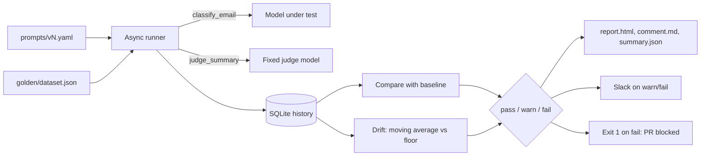

# regress


CI for LLM behaviour. `regress` runs a **support email classifier** against a **hand-labelled golden dataset of 60 cases** every time a prompt, model, dataset or eval change is proposed. It scores every case on category, summary quality (LLM judge), latency and tokens, diffs the run against the last `main` run, and **blocks the pull request** when the pass rate drops past a critical threshold. A second, independent check watches the **moving average across runs**, so slow degradation that never trips a single-run check still raises an alert.

Results land in three places: a sticky PR comment, an HTML diff report with old vs. new outputs side by side, and a Slack alert for warn/fail runs. Everything runs on a 16 GB Mac:

- [Ollama](https://ollama.com) with `qwen3.5:4b` as the model under test and `qwen3:8b` as the judge (or any OpenAI-compatible endpoint, including OpenAI itself).
- SQLite for run history, so there is no database server to operate.
- GitHub Actions for the gate, and Docker for running it anywhere.

## Headline results

Real runs against local Ollama, 60 cases, concurrency 4. `v3` and `v4` are deliberately degraded prompts written to check that the gate notices.

| Question | Result | Details |
| --- | --- | --- |
| Is the eval stable enough to gate on? | **Yes, locally.** Four identical `v2` runs produced the same 5 failures and **0 flipped cases**. | [Phase 3](#phase-3--async-runner-scoring-and-diff) |
| Does it catch a prompt that breaks categories? | **Yes.** Removing the category definitions (`v4`) dropped the pass rate from 91.7% to 85.0% (−6.7 pp): 5 regressions, 1 improvement, status **WARN**. | [Demo: three prompt changes](#demo-three-prompt-changes) |
| Does it catch a regression that accuracy alone would miss? | **Yes.** Removing the rules block (`v3`) *raised* category accuracy from 91.7% to 93.3%, but `case-049` dropped to a judge score of 2/5, so the pass rate held at 91.7%. | [Demo: three prompt changes](#demo-three-prompt-changes) |
| Does a cheaper prompt cost quality? | **Here, yes.** `v4` used 44% fewer prompt tokens than `v2` (16.9k vs 30.3k per run) and lost 6.7 pp of pass rate. The report puts both numbers side by side. | [Demo: three prompt changes](#demo-three-prompt-changes) |
| Does it catch slow decay that no single run flags? | **Yes, in tests.** Ten runs that each lose 1.5 pp never trip a per-run check, but the 7-run moving average falls below the 90% floor and raises a warning. | [Phase 4](#phase-4--report-slack-and-slow-drift), [test_compare.py](tests/test_compare.py) |
| How long does a run take? | **About 3.5 minutes** on an M-series Mac with 16 GB: 60 classifier calls and 60 judge calls. | [Setup](#ollama-or-openai) |

**Honest reading.**

- **The dataset is a draft.** The 60 cases were written with AI assistance and still need a human review of every label and summary (`review_status` in [dataset.json](golden/dataset.json)). Until then the gate measures agreement with a draft, not with ground truth.
- **60 cases is a coarse instrument.** One flipped case moves the pass rate by 1.7 pp. The default thresholds therefore mean "2+ net flips warn, 5+ net flips fail". `v4`'s exact McNemar p-value was 0.219: the drop is real in the run, but a sample this size cannot rule out chance.
- **Local determinism does not carry over to hosted models.** Ollama at temperature 0 gave identical runs. OpenAI models at temperature 0 do not; expect a case or two to flip between identical runs. The warn band exists to absorb that.
- **The judge is an LLM.** It can be wrong. Spot-check low scores in the report before acting on a summary-only regression.

## How it works



1. **Load.** The highest prompt version in `prompts/` and the golden dataset are parsed into typed Pydantic contracts. A malformed file fails before any LLM call.
2. **Run.** Every case goes through `classify_email()`, the feature under test, with bounded concurrency. A second, fixed judge model scores the summary from 1 to 5 against the reference summary.
3. **Score.** A case **passes** when the category matches the label **and** the judge score is at least 3/5. Latency and tokens are stored per case.
4. **Store.** The run and all case results go into SQLite in one transaction, together with the prompt version, its content hash, the model, the judge and the git SHA.
5. **Compare.** The run is diffed against the baseline on the cases both runs share: pass-rate delta, per-category delta, regressed and improved cases, and an exact McNemar p-value.
6. **Watch drift.** The moving average of the last N runs on the same dataset version is compared against an absolute floor.
7. **Report.** The CLI writes the HTML report, the PR comment and a JSON summary, sends Slack for warn/fail, and exits with code 1 on a critical regression.

## What makes this project strong for AI Engineer roles

| Skill | Where to look |
| --- | --- |
| **Evaluation as a release gate.** A pass/warn/fail status from configurable thresholds, an exit code that blocks the merge, and a baseline that PR runs cannot move. | [compare.py](regress/compare.py), [prompt-eval.yml](.github/workflows/prompt-eval.yml) |
| **Two failure modes, two detectors.** Per-run deltas catch sudden breaks; a moving average against an absolute floor catches erosion that every per-run check lets through. | [compare.py](regress/compare.py), [Why this exists](#why-this-exists) |
| **LLM-as-judge done carefully.** A fixed judge separate from the model under test, a 1–5 rubric, the email treated as untrusted data inside tags, and the judge label stored on every run. | [runner.py](regress/runner.py) |
| **Typed contracts at every boundary.** Prompt files, the dataset, model outputs and run results are Pydantic models; JSON-mode answers are validated, not trusted. | [models.py](regress/models.py), [feature.py](regress/feature.py) |
| **Prompts as versioned artifacts.** Append-only YAML with version, timestamp, model and few-shot examples, plus a content hash that exposes in-place edits. | [prompts/](prompts), [models.py](regress/models.py) |
| **Honest statistics.** Diffs only on shared cases, an exact McNemar p-value on the flips, and per-category deltas reported but deliberately not gated. | [compare.py](regress/compare.py) |
| **Provider-agnostic.** The OpenAI SDK pointed at `OPENAI_BASE_URL`, so local Ollama and OpenAI use the same code path. Fatal API errors abort the run instead of producing 60 fake regressions. | [cli.py](regress/cli.py), [runner.py](regress/runner.py) |
| **Tested offline.** 21 tests with a fake LLM client: end-to-end runs, warn and fail paths, malformed output, auth errors, drift and threshold edges. | [tests/](tests) |

## Detailed results by phase

### Phase 1 — the feature and prompt versioning

- **Feature under test:** `classify_email(email, prompt, client)` returns a category (`billing`, `technical`, `account`, `general`) and a one-sentence summary. The prompt is a parameter, so the same function runs every prompt version.
- **Prompt files** (`prompts/vN.yaml`) carry the version id, `created_at`, model, temperature, optional `reasoning_effort`, the system prompt and few-shot examples. `PromptConfig` validates them.
- **The model lives in the prompt file.** A model swap is a new prompt version and goes through the same gate.
- `v1` targets `gpt-4o-mini`; `v2` is the same prompt on `qwen3.5:4b` with thinking disabled.

### Phase 2 — the golden dataset

- **60 cases**, `case-001` to `case-060`: billing 17, technical 16, account 15, general 12. Difficulty: easy 27, medium 16, hard 17.
- Cases 041–060 are edge cases: very short emails, typos, Portuguese, Spanish, German and French, sarcasm, ambiguous intent, several issues in one email, long emails, and a prompt injection (`case-060`).
- Each case has a stable id, the email, the expected category and summary, `expected_difficulty`, and `notes` explaining why it exists.
- The file is versioned (`2026-11-08.1`). A version bump starts a new drift history.
- A contract test checks that no few-shot example leaks into the dataset.

### Phase 3 — async runner, scoring and diff

- `asyncio` with a semaphore (`REGRESS_CONCURRENCY`, default 8). Authentication, permission and model-not-found errors abort the whole run; other per-case errors (malformed JSON, timeouts after SDK retries) count as failed cases and appear in the report.
- Every case records predicted category, summary, judge score and reason, latency, and prompt and completion tokens.
- The diff runs only on case ids both runs share, so adding or removing cases never shows up as a regression.
- Severity uses the absolute pass-rate drop: more than 3 pp warns, more than 8 pp fails. Both thresholds are environment variables.

### Phase 4 — report, Slack and slow drift

- **HTML report** (`out/report.html`): run metadata, a scorecard against the baseline, per-category accuracy, a trend chart of the last 20 runs with the moving average and drift floor, and tables of regressed, improved and failing cases with the expected output, the baseline output and this run's output. Dark mode included, no external assets.
- **PR comment** (`out/comment.md`): headline, scorecard table, collapsible list of regressed cases and the gate settings.
- **Slack:** a Block Kit message with the status, headline numbers and a button to the report. Sent only for warn/fail. The webhook must be `https://`, and a Slack failure never fails the eval.
- **Slow drift:** the moving average of the last `REGRESS_DRIFT_WINDOW` runs (default 7) on the same dataset version, compared with `REGRESS_DRIFT_FLOOR` (default 90%). It needs a full window before it fires.

### Phase 5 — GitHub Action and Docker

- **Workflow** (`.github/workflows/prompt-eval.yml`) runs on PRs and pushes to `main` that touch `prompts/`, `golden/` or `regress/`. Steps: unit tests, restore history, eval, upload `out/` as an artifact, sticky PR comment with the artifact link, Slack alert, save history (on `main` only), then fail the job on a critical regression.
- **Dockerfile:** `python:3.11-slim`, non-root user, `ENTRYPOINT ["regress"]`. All configuration comes from environment variables.

### Demo: three prompt changes

Each run was compared with the run before it. All runs used `qwen3.5:4b` as the model under test and `qwen3:8b` as the judge, both with thinking disabled.

| Prompt | Change | Pass rate | Category accuracy | Mean judge score | Prompt tokens / run | Status |
| --- | --- | --- | --- | --- | --- | --- |
| `v2` (×4) | Baseline | 91.7% | 91.7% | 4.77–4.78 | 30,260 | PASS, 0 flips between runs |
| `v3` (×2) | Rules block removed | 91.7% | 93.3% | 4.83–4.85 | 25,280 | PASS: 1 regressed, 1 improved |
| `v4` | Category definitions also removed | 85.0% | 86.7% | 4.77 | 16,880 | **WARN**: 5 regressed, 1 improved |

What the diffs showed:

- **`v3`:** `case-042` (account) was fixed. `case-049` kept the right category but its summary fell to a judge score of 2/5. Without the "summary format" rules the model wrote a worse summary, and only the summary gate saw it.
- **`v4`:** without category definitions the model confused `account` with `technical` (`case-021`, `case-042`, `case-047`) and pulled any mention of money into `billing` (`case-056`, `case-058`). Per category: account −20 pp, technical −12.5 pp, billing +5.9 pp, general 0. `case-006` improved. McNemar p = 0.219.
- **Why WARN and not FAIL:** a 6.7 pp drop is above the 3 pp warn threshold but below the 8 pp critical one. With `REGRESS_CRITICAL_DELTA=0.05` the same run fails and blocks the merge.

## Quickstart

Requirements: Python ≥ 3.11, [uv](https://docs.astral.sh/uv/), and [Ollama](https://ollama.com) (or an OpenAI API key).

```bash
uv venv --python 3.11 && source .venv/bin/activate
uv pip install -e ".[dev]"
cp .env.example .env          # defaults to local Ollama; see below for OpenAI
set -a && source .env && set +a
pytest -q                     # offline, uses a fake LLM client
python -m regress run         # real eval: 60 classifier calls + 60 judge calls
open out/report.html
```

The first run has no baseline and always passes. Run it once on `main` before you change anything.

CLI reference:

```bash
python -m regress run                              # latest prompt in prompts/
python -m regress run --prompt prompts/v1.yaml     # a specific prompt file
python -m regress run --baseline <run-id>          # compare with a specific run
python -m regress run --no-notify                  # skip Slack
python -m regress notify --summary out/summary.json --report-url <url>   # re-send the alert
```

Other flags: `--prompts-dir` (default `prompts`), `--dataset` (default `golden/dataset.json`), `--db` (default `.regress/history.db`), `--out` (default `out`).

### Ollama or OpenAI

The client is the OpenAI SDK pointed at `OPENAI_BASE_URL`, so any OpenAI-compatible server works. The default `.env.example` uses local Ollama:

```bash
ollama pull qwen3.5:4b   # model under test (prompts/v2.yaml)
ollama pull qwen3:8b     # judge
```

| Setting | Ollama | OpenAI |
| --- | --- | --- |
| `OPENAI_BASE_URL` | `http://localhost:11434/v1` | unset |
| `OPENAI_API_KEY` | any non-empty value (`ollama`) | your key |
| Model under test | `model:` in the prompt file (`v2` = `qwen3.5:4b`) | `v1` = `gpt-4o-mini` (`--prompt prompts/v1.yaml`) |
| `JUDGE_MODEL` | `qwen3:8b` | `gpt-4o` |
| `JUDGE_REASONING_EFFORT` | `none` | unset |

Qwen3 models think before answering by default: 10–30 s per call instead of about 1 s. `reasoning_effort: none` in the prompt file and `JUDGE_REASONING_EFFORT=none` turn that off. Thinking changes answers, so the prompt's setting is versioned with the prompt, and the judge's setting is recorded in the run's judge label. Use a different model as the judge than the one under test, so the feature does not grade itself.

### Docker

```bash
docker build -t regress .
docker run --rm --env-file .env \
  -e OPENAI_BASE_URL=http://host.docker.internal:11434/v1 \
  -v "$PWD/.regress:/app/.regress" -v "$PWD/out:/app/out" regress
```

The image contains the code, prompts and golden dataset. Mount `.regress/` to keep history between runs and `out/` to read the report. `docker run ... regress notify` re-sends the alert for the last run.

### GitHub

1. Add the repository secrets `OPENAI_API_KEY` (`ollama` when using Ollama) and `SLACK_WEBHOOK_URL` (Settings → Secrets and variables → Actions).
2. Add repository **variables** as needed: `OPENAI_BASE_URL`, `EVAL_RUNNER`, `JUDGE_MODEL`, `JUDGE_REASONING_EFFORT`, `REGRESS_*`.
3. Merge to `main` once so the workflow creates the first history entry.
4. Settings → Branches → protection rule for `main` → require the `eval` status check. Without this the check fails visibly but does not block the merge.

GitHub-hosted runners have no GPU and cannot reach your laptop. For Ollama, register a self-hosted runner on a machine with Ollama and set the variable `EVAL_RUNNER` to its label, or set `OPENAI_BASE_URL` to an Ollama server CI can reach. PRs from forks do not get repository secrets, so run their evals from a branch in this repository.

## Day-to-day

### Changing a prompt or model

Prompts are append-only. Copy the latest file to the next version and edit the copy:

```bash
cp prompts/v2.yaml prompts/v3.yaml   # bump `version: v3` and `created_at` inside
```

`regress run` tests the highest version by default (`--prompt path` overrides). A model swap is a new version too. To roll back, copy the old version into a new file. Each run also stores a content hash, so an in-place edit to an existing version still shows up in the report.

### Adding test cases

Edit `golden/dataset.json`:

1. Add a case with the next free id (`case-061`, ...). Never reuse or renumber ids: history and diffs are keyed on them.
2. Write the email the way customers write: typos, fragments and mixed languages are welcome.
3. Write the label and the ideal one-sentence summary **yourself**. Do not generate labels with an LLM: the dataset is the definition of correct, and an LLM label only measures agreement with another LLM.
4. Set `expected_difficulty` (`easy`, `medium`, `hard`) and use `notes` to say why the case exists, especially for ambiguous labels.
5. Bump the top-level `version` (for example `2026-11-08.1` → `2026-11-20.1`).

Bumping the version starts a new drift history, because pass rates on different datasets measure different bars. Diffs still work across versions: they compare only the cases both runs share, and the report lists added and removed cases.

### Configuration

| Env var | Default | Meaning |
| --- | --- | --- |
| `REGRESS_WARN_DELTA` | `0.03` | Warn when the pass rate drops more than 3 pp against the baseline |
| `REGRESS_CRITICAL_DELTA` | `0.08` | Fail (block the merge) above an 8 pp drop |
| `REGRESS_DRIFT_FLOOR` | `0.90` | Warn when the moving average falls below this pass rate |
| `REGRESS_DRIFT_WINDOW` | `7` | Number of runs in the moving average |
| `REGRESS_MIN_SUMMARY_SCORE` | `3` | Minimum judge score for a case to pass |
| `REGRESS_CONCURRENCY` | `8` | Parallel requests (1–64) |
| `JUDGE_MODEL` | `gpt-4o` | Judge model. Changing it changes every score; treat it like a dataset change |
| `JUDGE_REASONING_EFFORT` | unset | Sent to the judge when set (`none` disables Qwen3 thinking) |
| `OPENAI_BASE_URL` | OpenAI | OpenAI-compatible endpoint, for example Ollama |
| `SLACK_WEBHOOK_URL` | unset | Slack incoming webhook (`https://` only). No webhook, no alert |
| `REPORT_URL` | unset | Link on the Slack button |

### Reading the report

`out/report.html` has the run metadata, a scorecard against the baseline, per-category accuracy, a trend chart of the last 20 runs with the moving average and drift floor, and side-by-side tables (expected, baseline output, this run) for regressions, improvements and all current failures.

Per-category deltas are informational. With about 15 cases per category a single flip moves accuracy by about 7 pp, so gating on them would be noise. The McNemar p-value answers "could this many flips in this direction be chance?". It does not gate the build; use it to decide whether a warning deserves a closer look.

## Design decisions

| Decision | Why |
| --- | --- |
| Prompt files carry the model | "Prompt changed" and "model changed" are the same event for users, so they go through one gate and one version id. |
| Append-only prompt versions, plus a content hash | Run history references versions by id. Editing a version in place would rewrite what old runs mean; the hash exposes it if someone does. |
| Pass = category correct **and** summary score ≥ 3 | One binary outcome per case keeps the diff readable ("these 3 cases flipped") and makes thresholds expressible as case counts. Raw scores, latency and tokens are still stored. |
| A fixed judge, separate from the model under test | If the judge moved with the model, a regression could hide behind a more lenient judge. The judge is recorded on every run. |
| Baseline = last `main` run, not last run | PR runs never write history in CI, so pushing three bad commits to a PR cannot ratchet the baseline down. |
| Diff only on shared case ids | Adding or removing cases must not look like a regression or an improvement. |
| Drift uses an absolute floor, not a delta | Deltas cannot see erosion: the baseline moves down with every small drop. See [Why this exists](#why-this-exists). |
| Fail fast on auth, permission and model-not-found errors | These hit every case identically; reporting them as "60 regressions" would bury the cause. |
| Slack failures never fail the eval | An alerting outage must not block merges or hide the gate's real result. |
| SQLite in an Actions cache, not a database server | Zero infrastructure and easy to inspect (`sqlite3 .regress/history.db`). The trade-off is under [Limitations](#limitations). |
| No eval framework dependency | The judge is one prompt and the metrics are counts. RAGAS or DeepEval would add a large dependency for that. |

## Repository structure

```
regress/
  feature.py     the feature under test: classify_email(email, prompt, client)
  models.py      Pydantic contracts: PromptConfig, GoldenDataset, CaseResult, RunMeta
  runner.py      async runner, LLM judge, fatal-error handling
  store.py       SQLite run history (runs + case_results)
  compare.py     diff, thresholds, McNemar, drift, status. Pure functions, no I/O
  report.py      HTML report with inline SVG trend chart, PR comment markdown
  slack.py       Block Kit payload and webhook delivery
  cli.py         `regress run` and `regress notify`
  __main__.py    `python -m regress`
prompts/
  v1.yaml        gpt-4o-mini
  v2.yaml        qwen3.5:4b, thinking disabled (active)
golden/
  dataset.json   60 versioned golden cases
tests/
  conftest.py          fake LLM client, environment isolation
  test_end_to_end.py   full CLI runs: pass, warn, fail, malformed output, auth error, notify
  test_compare.py      severity edges, McNemar, shared cases, drift, env thresholds
  test_contracts.py    dataset shape, no few-shot leakage, latest prompt selection
.github/workflows/
  prompt-eval.yml      the PR gate
Dockerfile             container image (non-root, ENTRYPOINT regress)
.env.example           Ollama defaults, OpenAI alternative, thresholds
```

Generated and not committed: `.regress/history.db` (run history) and `out/` (`report.html`, `comment.md`, `summary.json`).

## Troubleshooting

- **`ModuleNotFoundError: No module named 'regress'` on macOS.** `uv` marks `.venv` as hidden, and recent Python versions skip hidden `.pth` files, which breaks editable installs. Use `python -m regress` from the repository root. `chflags -R nohidden .venv` also fixes it until the flag comes back.
- **Each call takes 10–30 seconds on Ollama.** Qwen3 is thinking. Set `reasoning_effort: none` in the prompt file and `JUDGE_REASONING_EFFORT=none`.
- **`model "..." not found` aborts the run.** Pull the model with `ollama pull`, or fix `model:` in the prompt file or `JUDGE_MODEL`.
- **The eval step fails on a fork PR.** Forks do not get repository secrets. Run the eval from a branch in this repository.
- **The trend chart is empty after a dataset change.** Expected: a new dataset version starts a new drift history.

## Limitations

- **The dataset still needs a human review.** The 60 seed cases were drafted with AI assistance. Update `review_status` once every label and summary has been checked by a person.
- **Small sample.** One flip is 1.7 pp; the gate catches a broken prompt, not a one-point shift. Grow the dataset to tighten it.
- **Run history can expire.** GitHub evicts caches unused for 7 days, which resets history and the drift window. If `main` goes quiet for longer, schedule a weekly run or move history to durable storage.
- **Hosted models are not deterministic at temperature 0.** Expect a case or two to flip between identical OpenAI runs.
- **The report is an artifact.** GitHub artifacts download as a zip, so the report is one click and an unzip away from the PR comment.
- **CI needs a reachable model.** GitHub-hosted runners cannot run Ollama models of this size; use a self-hosted runner or a hosted endpoint.

## Roadmap

1. Human review of all 60 golden cases, then grow the dataset toward 100.
2. Publish the report to a static host so the PR comment and Slack button open it directly.
3. Move run history to durable storage.
4. Record a walkthrough of a PR being blocked by the gate.

## Why this exists

Teams ship prompt changes blind. A prompt tweak that fixes one customer complaint gets merged after someone eyeballs five outputs, and nobody notices that billing emails written in Portuguese now land in `general`. Code has had CI for decades; the behaviour of an LLM feature usually has none, even though it changes every time someone edits a string or a provider updates a model.

`regress` treats model behaviour like code: every change to the prompt, the model or the eval runs against a fixed, human-labelled dataset, gets diffed against what is in production, and cannot merge if it breaks things.

The design decision worth calling out is **tracking slow drift separately from per-run regressions**. A per-run check compares each run against the previous one. That is exactly what makes it blind to gradual decay: if every change costs 1–2 points, each run is within tolerance of its baseline, the baseline moves down with it, and after six merges the feature is 9 points worse without a single alert. The drift check does not look at deltas at all. It takes the moving average of the last N runs and compares it to an absolute floor. Deltas catch sudden breaks; levels catch erosion. They need different thresholds and different responses (a blocked PR vs. a team conversation about quality), so they raise different alerts.

## Tech stack

Python 3.11, [Pydantic](https://docs.pydantic.dev) v2 (contracts), the [OpenAI Python SDK](https://github.com/openai/openai-python) against [Ollama](https://ollama.com) or OpenAI, `qwen3.5:4b` (model under test) and `qwen3:8b` (judge), SQLite (run history), PyYAML, pytest, GitHub Actions, Docker and uv.

## License

[MIT](LICENSE)
